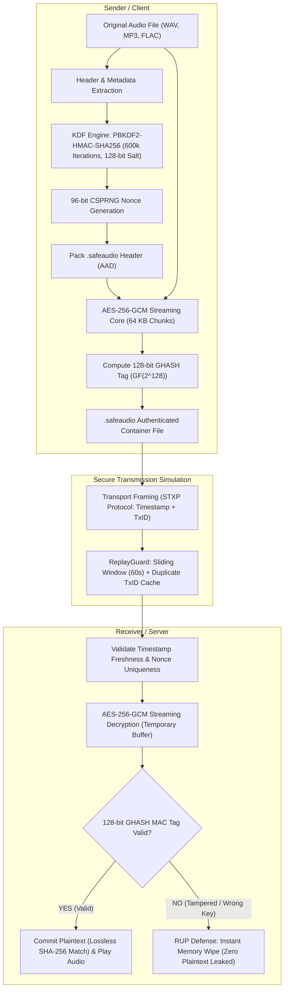

# Secure Digital Audio File Encryption using AES-256-GCM

[](https://www.python.org/downloads/)
[](https://csrc.nist.gov/publications/detail/sp/800-38d/final)
[-orange.svg)]()
[](https://csrc.nist.gov/publications/detail/sp/800-132/final)
[]()
[]()

> **M.Tech Cryptography & Information Security Dissertation Project**  
> An authenticated, tamper-evident digital audio encryption and transmission system supporting WAV, MP3, and FLAC containers. Combines Galois/Counter Mode (GCM), custom `.safeaudio` binary framing, Shannon entropy verification, short-time Fourier transform (STFT) spectrogram analysis, and network replay attack mitigation.

---

## 🎧 System Overview & Architecture



---

## 🚀 Key Technical Features

1. **Authenticated Encryption with Associated Data (AEAD):**
   - Implements **NIST SP 800-38D** GCM mode.
   - Eliminates padding oracle vulnerabilities present in CBC mode.
   - Binds all container metadata (filename, sample rate, channels, iterations) into the **Associated Authenticated Data (AAD)**.
2. **Release of Unverified Plaintext (RUP) Defense:**
   - Decrypted streams are quarantined in temporary storage until the 128-bit GHASH authentication tag is verified.
   - If an attacker flips a single bit in the ciphertext or header, the decryption engine raises `AuthenticationError` and instantly deletes all unverified bytes.
3. **Constant Space Complexity ($O(1)$ Overhead):**
   - High-throughput 64 KB chunked streaming architecture.
   - Fixed header expansion of only **325–327 bytes**, keeping memory footprint $< 1\text{ MB}$ even for multi-gigabyte audio files.
4. **Replay Attack Defense:**
   - Network socket protocol incorporates a **$\pm 60$-second sliding timestamp window** and a **16-byte CSPRNG Transaction ID (TxID) cache**.
5. **Shannon Entropy & Acoustic Spectrogram Analysis:**
   - Measures ciphertext randomness ($H = 7.99764\text{ bits/byte}$, approaching theoretical maximum $8.0$).
   - Short-Time Fourier Transform (STFT) proves zero frequency formant leakage into ciphertext.

---

## 📊 Empirical Performance Benchmarks

*Empirically measured on Apple Silicon M-series hardware running Python 3.14 across multiple trials:*

| Audio Category | File Size | Encryption Time | Decryption Time | Encryption Speed | Decryption Speed | Storage Overhead | Lossless SHA-256 |
| :--- | :--- | :--- | :--- | :--- | :--- | :--- | :--- |
| **Short Tone** | 250 KB | 24.7 ms | 23.5 ms | 9.5 MB/s | 10.0 MB/s | 325 B (0.13%) | Verified 100% |
| **Voice Memo** | 1.0 MB | 26.6 ms | 26.6 ms | 36.8 MB/s | 36.6 MB/s | 327 B (0.03%) | Verified 100% |
| **Full Song** | 5.0 MB | 42.6 ms | 42.7 ms | **114.6 MB/s** | **114.2 MB/s** | 327 B (0.006%) | Verified 100% |

> **Key Research Finding:** The baseline PBKDF2 derivation work-factor ($\approx 22\text{ ms}$) amortizes over larger audio streams, allowing the streaming AES-256-GCM engine to scale from 9.5 MB/s to over **114 MB/s**.

---

## 🛠️ Installation & Setup

### 1. Clone the Repository
```bash
git clone https://github.com/<your-username>/secure-audio-encryption.git
cd secure-audio-encryption
```

### 2. Set Up Virtual Environment
```bash
python3 -m venv .venv
source .venv/bin/activate
pip install -r requirements.txt
```

### 3. Generate Pristine Test Audio Files
```bash
python generate_test_audio.py
```
*Generates test audio files in `sample_audio/`: Concert Pitch Tone (440 Hz), C-Major Chord (Stereo), and Vocal Range Frequency Sweep.*

---

## 🖥️ Running the Application

### Modern Desktop GUI (CustomTkinter)
```bash
python run_gui.py
```
- **Tab 1:** Select audio file (WAV/MP3/FLAC), enter passphrase, and encrypt.
- **Tab 2:** Authenticate container, decrypt, and play restored audio with the built-in system player.
- **Tab 3 (Examiner Tamper Lab):** Inject live 1-bit corruption into ciphertext to demonstrate instant MAC rejection.
- **Tab 4:** Open publication-quality 200 DPI spectrogram and performance charts.

### Automated Test Suites
```bash
python tests/test_milestone2.py          # Key management & container packing
python tests/test_milestone3.py          # AES-256-GCM AEAD core & lossless SHA-256
python tests/test_milestone4_security.py # Shannon entropy, Chi-square & spectrograms
python tests/test_milestone5_transmission.py # Socket streaming & ReplayGuard
python benchmarks/run_benchmarks.py      # Real empirical throughput benchmarks
```

---

## 📁 Repository Structure

```text
secure-audio-encryption/
│
├── requirements.txt              # Core project dependencies
├── run_gui.py                    # Graphical desktop application launcher
├── generate_test_audio.py        # Test tone and chord audio generator
├── verify_env.py                 # Diagnostic environment verification
│
├── src/                          # Modular source package
│   ├── core/
│   │   ├── cipher.py             # AES-256-GCM streaming AEAD engine
│   │   ├── key_manager.py        # PBKDF2, Salt & CSPRNG Nonce manager
│   │   ├── container.py          # .safeaudio binary format serializer
│   │   └── security_analyzer.py  # Shannon entropy & STFT spectrogram generator
│   ├── audio/
│   │   └── audio_handler.py      # WAV/MP3 inspection & SHA-256 checksums
│   ├── network/
│   │   ├── protocol.py           # STXP wire framing & ReplayGuard
│   │   ├── sender.py             # Authenticated client sender
│   │   └── receiver.py           # Authenticated server receiver
│   └── gui/
│       └── app.py                # CustomTkinter dark-mode desktop GUI
│
├── tests/                        # Automated security & unit test suites
│   ├── test_milestone2.py
│   ├── test_milestone3.py
│   ├── test_milestone4_security.py
│   ├── test_milestone5_transmission.py
│   └── test_milestone7_gui.py
│
├── benchmarks/                   # Performance benchmarks
│   ├── benchmark_engine.py
│   ├── plot_benchmarks.py
│   └── run_benchmarks.py
│
└── docs/                         # Dissertation documentation & plots
    ├── PROJECT_REPORT.md         # Full IEEE-style M.Tech dissertation paper
    ├── VIVA_QUESTIONS.md         # 14+ section comprehensive viva question bank
    ├── THREAT_MODEL.md           # Formal STRIDE threat model
    ├── security_analysis_spectrogram.png # 6-panel security analysis figure
    └── performance_benchmark_charts.png  # 4-panel empirical benchmark figure
```

---

## 📜 Academic Attribution & License
Developed for M.Tech Dissertation in Cryptography & Information Security.  
Licensed under the [MIT License](LICENSE).
